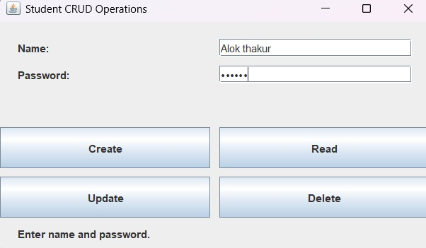
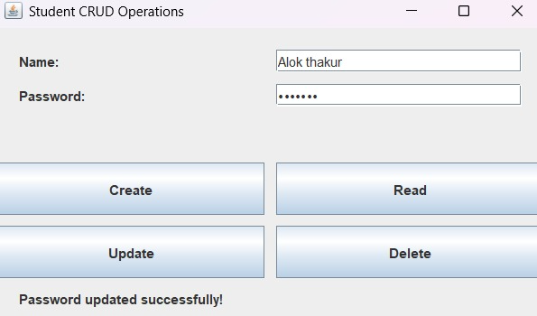

[<- Back to All Practicals](https://github.com/aloksingh2007k/OOP-Assignment)

---

# Practical 12 - Student CRUD Operations Using Java Swing

## Question
Write a program to implement full CRUD (Create, Read, Update, Delete) operations for a Student Registration system using Java Swing with proper CSV file persistence and input validation.

## Language
Java

## Program File
`StudentCRUD.java`

## Data Storage File
`students.csv`

## Description
This program implements a comprehensive Student CRUD portal using Java Swing. It provides a clean GUI with Name and Password input fields and four dedicated action buttons — Create, Read, Update, and Delete. All student records are stored persistently in a CSV file (`students.csv`) using a robust RFC 4180-compliant CSV parser and writer. The program also validates for duplicate names on create, confirms before deleting, and displays all records in a scrollable dialog on Read.

## Output Screenshots

**Create / Main Screen:**

**Update Operation:**

